<!-- ===================== ANIMATED HEADER ===================== -->
<div align="center">


<a href="https://github.com/TrivediMan/Customer-Churn-prediction">
  
</a>

<br/>


</div>

---

# 🎥 Project Video


🔗 **[▶️ Watch Project Video](https://drive.google.com/file/d/1hp8G6ceAHJGb_ePIzEmJZYx5Y0InOMYR/view?usp=drive_link)**

---
<br/><br/>

<a href="https://YOUR_VIDEO_LINK_HERE">
  
</a>

</div>

> 💡 **Tip:** Replace `https://YOUR_VIDEO_LINK_HERE` with your YouTube / Loom / Drive link, and `VIDEO_ID` with your YouTube video ID. For an animated preview, record a short GIF of the notebook running, save it as `assets/demo.gif` and add `` here.

---

## 🧠 The Business Problem

> Keeping a customer is far cheaper than winning a new one. This project builds an ML system that **flags at-risk telecom subscribers early**, so the retention team can act before revenue is lost.

<div align="center">

| Prediction | What it means | Business impact |
|:---:|---|---|
| ✅ **True Positive** | Churner correctly flagged | Retention offer well spent |
| ✅ **True Negative** | Loyal customer left alone | No cost |
| ⚠️ **False Positive** | Loyal customer flagged | Wasted discount budget |
| ❌ **False Negative** | **Churner missed** | **Lost recurring revenue (costliest)** |

</div>

🎯 Because missed churners are the most expensive error, the project optimises for **Recall** on the churn class.

---

## 🔄 Project Pipeline

```mermaid
flowchart LR
    A[📂 Raw Data<br/>7,043 customers] --> B[🔍 EDA]
    B --> C[🧹 Cleaning]
    C --> D[🔧 Feature<br/>Engineering]
    D --> E[📏 Scaling]
    E --> F[⚖️ SMOTE]
    F --> G[🤖 Train 4 Models]
    G --> H[📈 Compare]
    H --> I[🔬 Error Analysis]
    I --> J[🚀 Pipeline .pkl]

    style A fill:#0f2027,stroke:#00d9ff,color:#fff
    style F fill:#203a43,stroke:#ff9800,color:#fff
    style H fill:#203a43,stroke:#4caf50,color:#fff
    style J fill:#2c5364,stroke:#e91e63,color:#fff
```



---

## 📊 Dataset

**IBM Telco Customer Churn**

| Property | Value |
|---|---|
| 👥 Customers | **7,043** |
| 🧾 Features | **21** (demographics, services, billing) |
| ⚖️ Class split | **73.5% retained** vs **26.5% churned** |
| 🧹 Data quality | No duplicates, blank `TotalCharges` cleaned with median |

---

## 🔧 Feature Engineering

| Feature | Description |
|---|---|
| 🏷️ `tenure_group` | Customers bucketed into **New / Mid / Senior / Loyal** |
| 🛒 `num_services` | Number of add-on services subscribed |
| 💳 `AutoPay` | Flag for automatic payment methods |
| 🔢 One-Hot Encoding | `InternetService`, `Contract`, `PaymentMethod` |
| 📏 Scaling | `StandardScaler` on tenure, charges, num_services |

**⚖️ Imbalance strategy:** SMOTE applied **only on the training split** (so the test set stays realistic), compared against `class_weight='balanced'`.

---

## 🤖 Model Showdown

<div align="center">

| Model | Accuracy | Precision | **Recall** | F1 | AUC-ROC | Train Time |
|---|:---:|:---:|:---:|:---:|:---:|:---:|
| Naive Bayes (SMOTE) | 0.713 | 0.476 | **0.797** | 0.596 | 0.815 | 0.02 s |
| SVM – RBF (SMOTE) | 0.747 | 0.516 | 0.778 | 0.620 | 0.822 | 44.45 s |
| 🏆 **Decision Tree (Balanced)** | **0.749** | **0.518** | 0.778 | **0.622** | **0.829** | **0.04 s** |
| KNN (SMOTE) | 0.708 | 0.467 | 0.698 | 0.559 | 0.757 | 0.01 s |

</div>

### 🏆 Why the Decision Tree Wins

- 🥇 Highest **AUC-ROC (0.829)** and **F1 (0.622)**
- 🎯 Recall virtually tied with the best model
- ⚡ Trains about **1,000× faster than SVM**
- 🔍 **Fully interpretable**, so business teams can trust and act on it

---

## 🔍 Key Insights

### 🎯 What Drives Churn?

```
Contract: Two year        ████████████████████  40.8%
Contract: One year        ████████████▌         25.5%
Internet: Fiber optic     █████▌                11.2%
Tenure                    ████▌                  9.4%
Monthly Charges           ██▎                    4.6%
```

> **Contract type is the #1 lever.** Short-tenure, month-to-month customers on fiber are the highest-risk group.

### ❌ Who Does the Model Miss?

Of the **83 missed churners** (false negatives):

| Metric | Missed Churners | All Churners |
|---|:---:|:---:|
| ⏳ Avg. tenure (months) | **29.2** | 16.5 |
| 💰 Avg. monthly charge | **$63.2** | $72.8 |
| 📄 On one-year contract | **43.4%** | 9.6% |

> These are **loyal-looking, mid-tenure customers who leave at renewal time**, a perfect target for a dedicated renewal campaign.

---

## 🚀 Quick Start

```bash
# 1️⃣ Clone
git clone https://github.com/TrivediMan/Customer-Churn-prediction.git
cd Customer-Churn-prediction

# 2️⃣ Install
pip install -r requirements.txt

# 3️⃣ Run the notebook
jupyter notebook Notebook/
```

### 🔮 Use the trained model

```python
import joblib

model = joblib.load("Model/churn_model.pkl")

# customer_df must have the same columns as the training data
prediction  = model.predict(customer_df)             # 1 = will churn
probability = model.predict_proba(customer_df)[:, 1] # churn risk score
```

---

## 📁 Repository Structure

```
Customer-Churn-prediction/
├── 📊 Data/            → Telco-Customer-Churn.csv
├── 🤖 Model/           → churn_model.pkl (scaler + Decision Tree pipeline)
├── 📓 Notebook/        → Full analysis & modelling
├── 📋 requirements.txt
└── 📘 README.md
```

---

## 💡 Business Recommendations

1. 📝 **Incentivise longer contracts**, the strongest retention signal.
2. 🌐 **Audit fiber optic pricing and quality**, a clear churn driver.
3. 🎁 **Strengthen first-year onboarding**, when risk is highest.
4. 🔔 **Run renewal-time outreach** for the one-year customers the model tends to miss.

---

## 🔮 Future Improvements

- [ ] Hyperparameter tuning (GridSearchCV / Optuna)
- [ ] Ensembles: Random Forest, XGBoost, LightGBM
- [ ] Cost-based threshold tuning (FN vs FP cost)
- [ ] SHAP explanations per customer
- [ ] Streamlit / FastAPI web app

---

## 🛠️ Tech Stack

<div align="center">


</div>

---

## 👤 Author

<div align="center">

**Man Trivedi**

[](https://github.com/TrivediMan)
[](https://linkedin.com/in/YOUR_PROFILE)

⭐ **If you found this useful, please star the repo!** ⭐


</div>
